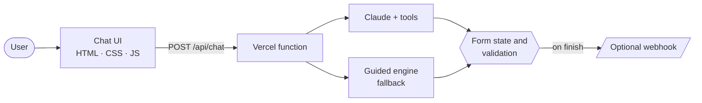

<h1 align="center">🤖 ChatBit · Asistente Neo</h1>

<p align="center">
  AI assistant that guides people, step by step, through the credit registration form of
  <a href="https://neocredito.bancoldex.com/neocredito/home">Neocrédito</a>, Bancóldex's digital credit platform.
</p>

<p align="center">
  <a href="https://asistente-neo.vercel.app/"></a>
</p>

<p align="center">
  
  
  
  
  
</p>

<p align="center">🇪🇸 <a href="README.es.md">Versión en español</a></p>

---

## Why

Many small-business owners in Colombia are not used to digital forms, and long registration forms are where they give up. ChatBit turns Neocrédito's *natural person registration form* into a conversation: people answer in their own words and the assistant fills in the form for them.

Built as the industry challenge of an Artificial Intelligence course at Icesi University, with Bancóldex Neocrédito as the partner case.

## How it works

| | |
|---|---|
| 🧠 **AI mode** | Claude talks in natural language and stores data through tools (`guardar_datos`, `finalizar_registro`). It understands free-form answers such as *"me llamo Ana Pérez, cc 1144…"*, *"vendí como 10 millones"* or *"tengo una peluquería en Cali"* (→ CIIU 9602, Valle del Cauca). |
| 🧭 **Guided mode** | If there is no API key or the AI fails, a deterministic engine asks field by field with the same validations, so the bot never stops answering. |
| ✅ **Server-side validation** | The AI proposes values, but code decides: 10-digit mobile numbers starting with 3, valid emails, matching document confirmation, Colombian departments, amounts in pesos and explicit consents. Browser state is re-validated on every message. |
| 📝 **Live form panel** | "Tu formulario" shows the form filling up in real time. |
| 🧾 **Confirmation** | A final summary, explicit confirmation and a filing number (`NEO-AAAAMMDD-XXXXXX`). |
| 🔌 **Embeddable** | One `<script>` tag adds a floating "Solicita tu crédito" button to any page. |

The flow covers both parts of the real form:

| Part | Fields |
|---|---|
| 1. General information | First name, last name, document type and number (with confirmation), gender, mobile, email, RUT, how they heard about Neocrédito |
| 2. Financial information | Business department and city, contact channel, minority group, economic activity (CIIU), sales year, last year's sales, data policy and terms |

## Architecture



```
api/chat.js        Vercel serverless function (POST /api/chat)
lib/form.js        Fields, validations and form state
lib/catalogs.js    Document types, departments, cities, CIIU codes, links
lib/ai.js          Conversation with Claude + tools
lib/guided.js      Guided engine (fallback without AI)
lib/submit.js      Completion and optional webhook delivery
public/            Chat interface (no frameworks) and embed.js
scripts/dev.js     Dependency-free local server
tests/             Tests (node --test)
```

## Run locally

Requires Node.js 20+. There are no dependencies to install.

```bash
cp .env.example .env      # add your ANTHROPIC_API_KEY (optional)
npm run dev               # http://localhost:3000
npm test
```

## Environment variables

| Variable | Required | Description |
|---|---|---|
| `ANTHROPIC_API_KEY` | For AI mode | Key from https://console.anthropic.com |
| `ANTHROPIC_MODEL` | No | Defaults to `claude-haiku-4-5-20251001` |
| `SUBMIT_WEBHOOK_URL` | No | If set, the final registration is POSTed there as JSON; otherwise submission is simulated |
| `SUBMIT_WEBHOOK_TOKEN` | No | Sent as `Authorization: Bearer …` to the webhook |
| `POLICY_URL`, `TERMS_URL` | No | Links to the data policy and terms |

## Deploy to Vercel

1. Import `JEGH18/ChatBit` at https://vercel.com/new (Framework Preset: **Other**, no build command).
2. Add `ANTHROPIC_API_KEY` under *Settings → Environment Variables*.
3. Deploy. Every push to `main` redeploys.

## Embed in another page

```html
<script src="https://YOUR-PROJECT.vercel.app/embed.js" defer></script>
```

## Notes

- Some dropdown options and the CIIU catalog are a reasonable subset of the real form; adjust them in `lib/catalogs.js`.
- Submission is simulated unless `SUBMIT_WEBHOOK_URL` is set. The server does not store or log personal data.
- This is an academic prototype: it does not make credit decisions and is not an official Bancóldex product.
