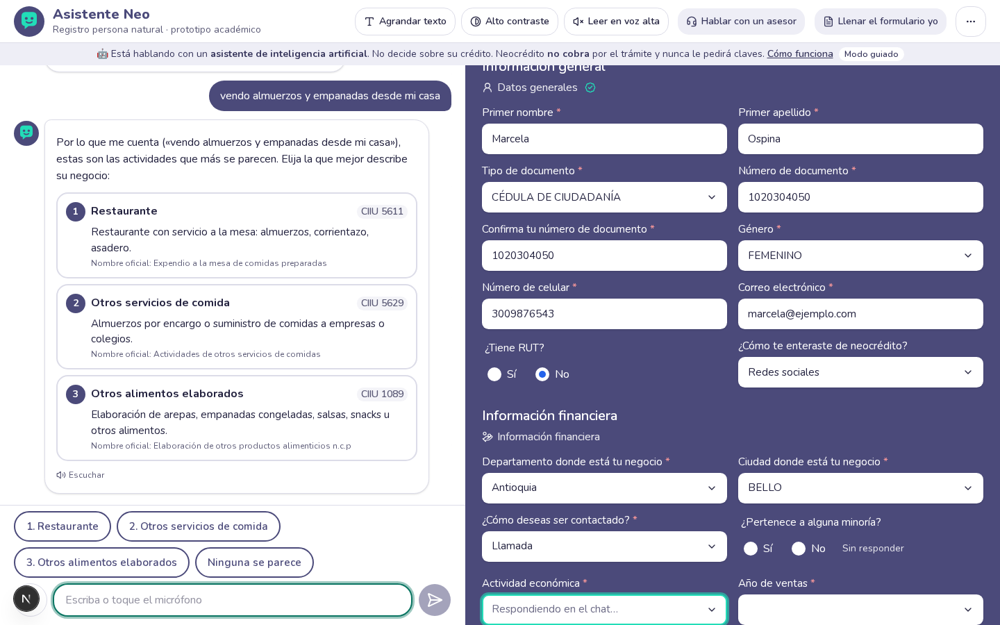

# Asistente Neo — registro en Neocrédito con IA (prototipo)

Prototipo de un **asistente conversacional con inteligencia artificial** que guía a microempresarios, paso a paso y en lenguaje sencillo, hasta completar correctamente el **Formulario de registro persona natural** de [Neocrédito](https://neocredito.bancoldex.com/neocredito/home), el canal digital de Bancóldex que conecta a microempresarios con unas 30 entidades financieras aliadas.

> Proyecto académico para el curso de IA de la Universidad Icesi. **No es un producto oficial** de Bancóldex ni de Neocrédito, no usa sus logotipos y **no envía nada a Neocrédito**: al final genera un JSON con la estructura del formulario.



## El problema

Muchas personas (microempresarios personas naturales, negocios informales y adultos mayores con poca experiencia digital) abandonan el formulario o lo llenan mal. Los campos con más faltantes son **ventas** y **actividad económica (CIIU)**, y la brecha digital, asociada sobre todo a la edad, hoy se compensa con acompañamiento presencial.

## Qué hace

| | |
|---|---|
| **Conversación natural** | La persona responde como quiera («me llamo Domiciano Rincón y vivo en Cali») y el asistente llena varios campos a la vez. Si algo es ambiguo, pregunta; nunca adivina. |
| **Vista previa en vivo** | A la derecha (pestaña en celular) se ve el formulario oficial llenándose. Cualquier campo se corrige tocándolo. |
| **Actividad económica (CIIU)** | «Vendo empanadas en la esquina» → las 3 actividades más probables, explicadas en lenguaje sencillo, para que la persona elija. |
| **Ventas del último año** | Entiende «unos 2 millones al mes» o «10 palos»; si la persona no sabe, calcula con ella (venta diaria × días × semanas), muestra la cuenta y pide confirmación. |
| **Consentimientos** | Resumen en 3 viñetas y enlace al texto completo. La aceptación siempre es un botón que toca la persona. |
| **Accesibilidad** | Voz (es-CO) para hablar y para escuchar, texto grande, alto contraste, botones de 44 px o más, trato de «usted». Auditado con axe: 0 violaciones WCAG 2.1 AA. |
| **Siempre hay salida** | Pasar al formulario manual sin perder nada, o hablar con un asesor (WhatsApp/teléfono configurables). |
| **Resumen final y encuesta** | Tarjeta para revisar todo antes de «Finalizar registro» y encuesta de 1 pregunta (😞 😐 🙂). |
| **Aprende sin datos personales** | Analítica de fricción anonimizada, bandeja de preguntas sin resolver (humano en el bucle) y sinónimos CIIU confirmados. Panel en `/admin`. |
| **Funciona sin internet** | Si la red o la IA fallan, el mismo motor corre en el navegador. `/demo` reproduce las 3 personas de prueba sin conexión. |

## Cómo funciona (en una frase)

Una **máquina de estados determinista** decide el orden de los campos, qué falta y cuándo se puede avanzar; **Zod** valida cada dato; **Claude** (vía Vercel AI SDK) solo entiende el lenguaje, extrae campos con herramientas, explica y sugiere. La IA propone; el código decide. Detalle en [docs/arquitectura.md](docs/arquitectura.md).

## Correrlo en local

Requisitos: Node.js 20.9 o superior (probado con Node 24) y npm.

```bash
git clone https://github.com/JEGH18/ChatBit.git && cd ChatBit
git checkout feat/asistente-neo        # rama de esta versión
npm install                            # también genera el cliente de Prisma
cp .env.example .env.local             # ponga ANTHROPIC_API_KEY (opcional) y ADMIN_PASSWORD
npx prisma migrate deploy              # crea prisma/dev.db (SQLite)
npm run dev                            # http://localhost:3000
```

- **Sin `ANTHROPIC_API_KEY`** el asistente funciona en **modo guiado** (reglas, sin IA). Con la clave, usa Claude y cae al modo guiado si la IA falla.
- Panel: http://localhost:3000/admin (contraseña `ADMIN_PASSWORD`). Para verlo con datos: botón **«Cargar datos sintéticos»** o `npm run db:demo`.
- Modo demo sin conexión: http://localhost:3000/demo
- Transparencia para la persona usuaria: http://localhost:3000/como-funciona

### Scripts

| Comando | Qué hace |
|---|---|
| `npm run dev` / `build` / `start` | Desarrollo, compilación y servidor de producción |
| `npm test` | Pruebas unitarias (Vitest): montos, validadores, máquina de estados, motor con 3 personas, **equidad**, IA con modelo simulado, analítica |
| `npm run test:e2e` | Pruebas E2E (Playwright): las 3 personas de punta a punta, accesibilidad, red caída, panel |
| `npm run evals` | Evaluación de extracción y CIIU (`-- --ia` para incluir Claude; `-- --dataset evals/dataset-prueba.json` para el conjunto de prueba) |
| `npm run demo:grabar` | Regenera las conversaciones de `/demo` (`-- --ia` graba respuestas reales de Claude) |
| `npm run db:demo` | Carga 150 sesiones sintéticas (conversaciones simuladas contra el motor real); `-- borrar` las elimina |
| `npm run datos:divipola` / `datos:ciiu` | Regeneran los catálogos desde datos.gov.co o un archivo del DANE |
| `npm run typecheck` / `lint` | Tipos y estilo |

## Resultados de pruebas y evaluaciones

Medidos en este repositorio el 2026-10-30:

| Qué | Resultado |
|---|---|
| Pruebas unitarias (Vitest) | 80 de 80 |
| Pruebas E2E (Playwright, escritorio y celular) | 9 de 9 |
| Accesibilidad (axe, WCAG 2.1 AA) | 0 violaciones en `/`, alto contraste, `/demo` y `/como-funciona` |
| Extracción con reglas, **conjunto de prueba** (8 mensajes no usados para ajustar) | Precisión 100 %, cobertura 87 %, F1 93 % |
| CIIU con búsqueda léxica, **conjunto de prueba** (7 descripciones) | Top-1 85,7 %, top-3 100 % |
| Extracción y CIIU, conjunto de desarrollo (32 casos, usado para ajustar) | F1 100 %; CIIU top-1 94,4 %, top-3 100 % |

Las cifras del conjunto de desarrollo son optimistas por construcción. Las de Claude se obtienen con `npm run evals -- --ia` (requiere clave; ver *Limitaciones*).

## Desplegar en Vercel

1. Importe el repositorio en https://vercel.com/new (Next.js se detecta solo).
2. Variables de entorno (ver `.env.example`): `ANTHROPIC_API_KEY`, `ADMIN_PASSWORD`, `ADMIN_SECRET` y las `NEXT_PUBLIC_*` que quiera cambiar.
3. Persistencia, una de dos:
   - **Sin base de datos** (lo más simple para la demo): no defina `DB_DRIVER`. En Vercel se usa memoria: la analítica vive mientras la instancia esté activa.
   - **Con Postgres** (Vercel Postgres/Neon): `DB_DRIVER=postgres`, `DATABASE_URL=...` y ejecute una vez `DB_DRIVER=postgres npx prisma migrate deploy` (o `prisma db push`) contra esa base.
4. Deploy. La ruta `/api/chat` usa streaming y `maxDuration = 30` s.

Con la CLI: `npm i -g vercel && vercel link && vercel env add ANTHROPIC_API_KEY && vercel --prod`.

## Estructura

```
app/                    páginas (/, /demo, /como-funciona, /admin) y rutas de API (chat, encuesta, admin)
components/asistente/   chat, vista previa del formulario, editor de campos, voz, preferencias
components/admin/       gráficos del panel (sin librerías)
lib/form/               campos, catálogos, DIVIPOLA, CIIU, parser de montos y validadores Zod
lib/conversacion/       máquina de estados, motor guiado, extractor de reglas, acciones
lib/ia/                 Claude: prompt, herramientas, clasificación CIIU, turno con streaming
lib/conocimiento/       base de preguntas frecuentes (RAG léxico)
lib/analitica/          registro sin PII y cálculo de métricas
lib/datos/              repositorio (Prisma SQLite/Postgres o memoria) y datos sintéticos
lib/seguridad.ts        claves/OTP, inyección de prompt, anonimización
data/                   DIVIPOLA, CIIU (completo y frecuentes), FAQ en Markdown, demos grabadas
prisma/                 esquema y migraciones
evals/                  conjuntos de evaluación y script
tests/unit, e2e/        pruebas
docs/                   arquitectura, IA responsable, métricas de la propuesta
```

### Catálogo CIIU completo del DANE

`data/ciiu/frecuentes.json` trae 167 actividades frecuentes en microempresas con explicación sencilla y palabras coloquiales (es lo que más pesa en las sugerencias). `data/ciiu/catalogo-completo.json` trae las 499 clases de la CIIU Rev. 4 A.C. (fuente: datos.gov.co) y se usa para validar cualquier código y como respaldo de la búsqueda. Para cargar la versión oficial del DANE: descargue la estructura en Excel desde dane.gov.co (Clasificaciones → CIIU Rev. 4 A.C.), exporte las clases (4 dígitos) a CSV con dos columnas (código; descripción) y ejecute `npm run datos:ciiu -- ruta/archivo.csv`.

## Suposiciones

Tomadas sin bloquear el trabajo (todas configurables):

- **Opciones de los selects**: tipos de documento CC, CE, pasaporte y PPT; género Masculino, Femenino, Otro y «Prefiero no decir» (`NEXT_PUBLIC_GENERO_PREFIERO_NO_DECIR`); «¿Cómo te enteraste?» con Eventos, Redes sociales, Recomendación, Entidad financiera y Otro; año de ventas = los dos últimos años cerrados. Se ajustan en `lib/form/catalogos.ts`.
- **Reglas de documento**: CC 6–10 dígitos; CE 5–10; PPT 5–12; pasaporte 5–15 letras o números.
- **Ventas**: entero positivo en pesos; cifras menores a 1 millón o mayores a 5.000 millones piden confirmación (no se corrigen solas).
- **Datos personales solo en el navegador** (localStorage, 24 h). El servidor guarda solo analítica sin PII. La IA no recibe documento, celular, correo, género ni minoría en el estado del formulario (sí ve lo que la persona escribe).
- **Rango de edad**: no está en el formulario, así que solo se pregunta de forma **opcional y anónima en la encuesta final** (minimización de datos). Ver la limitación de sesgo de supervivencia.
- **Modelos**: `claude-sonnet-5-5` para conversar y extraer (effort `low`, `fallbacks: "default"`, sin `temperature`) y `claude-haiku-5-5` para re-ordenar CIIU. Cambie con `ANTHROPIC_MODEL` / `ANTHROPIC_MODEL_CLASIFICACION`.
- **Asesor**: WhatsApp y teléfono ficticios (`NEXT_PUBLIC_ASESOR_*`). Política y términos enlazan a las URL públicas de Bancóldex/Neocrédito (`NEXT_PUBLIC_POLITICA_DATOS_URL`, `NEXT_PUBLIC_TERMINOS_URL`).
- **Identidad visual**: colores inspirados en el canal (morado #4B4A7A, verde agua #22DDB8), nombre «Asistente Neo» y avatar propio; sin logotipos oficiales.
- **Radicado**: `DEMO-AAAAMMDD-XXXXXX`, solo para la demostración.

## Limitaciones conocidas

- **Claude no se probó en vivo en este equipo** (no había `ANTHROPIC_API_KEY`). La ruta con IA está cubierta con un modelo simulado del AI SDK (herramientas, validación, CIIU, ventas, respaldo) y se verificó contra la API real que una clave inválida cae al modo guiado sin que la persona lo note. Antes de presentar: ponga la clave, converse y ejecute `npm run evals -- --ia` y `npm run demo:grabar -- --ia`.
- **Evaluaciones pequeñas** (40 casos en total) escritas por el mismo equipo que hizo el catálogo; el conjunto de prueba es honesto pero chico. En el piloto deben medirse con mensajes reales anonimizados.
- **Sesgo de supervivencia en la edad**: como la edad se pregunta al final, los segmentos de edad solo incluyen a quienes terminaron. El segmento por canal (voz/texto) sí cubre todas las sesiones.
- **Peso inicial**: ~295 KB de JavaScript comprimido en la página principal (React/Next ≈ 120 KB; el resto son Zod, catálogos y el motor que permite funcionar sin red). Siguiente paso: enviar las etiquetas desde el servidor y cargar el motor local solo si falla la red.
- **Persistencia**: en Vercel sin Postgres la analítica se guarda en memoria y se pierde al reciclar la instancia. Los límites de uso (`lib/servidor/limites.ts`) también son por instancia.
- **Voz**: depende del navegador (Chrome, Edge y Safari reconocen voz; Firefox no). Siempre se puede escribir.
- **Panel**: contraseña simple y cookie firmada; en producción debería usarse el SSO de la entidad.
- **Base local de desarrollo**: `prisma/dev.db` conserva 63 sinónimos y 4 preguntas de las primeras cargas sintéticas, anteriores a la marca `sintetica`. Para empezar limpio: `npx prisma migrate reset` (borra la base local) y `npm run db:demo`.

## Documentación

- [docs/arquitectura.md](docs/arquitectura.md): diagramas (Mermaid) del flujo, de un turno y del modelo de datos.
- [docs/ia-responsable.md](docs/ia-responsable.md): riesgos, mitigaciones y relación con los 5 ejes del diagnóstico de justicia algorítmica del canal.
- [docs/metricas-propuesta.md](docs/metricas-propuesta.md): KPIs del piloto con su fórmula y fuente.

## Versión anterior

La primera versión (JavaScript sin framework, commit `4025390`) sigue en el historial de git. Esta versión portó a TypeScript su lógica de catálogos, parsers y flujo guiado.
