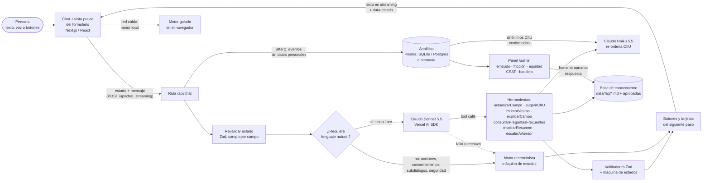
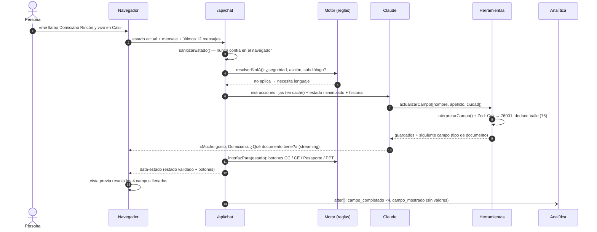
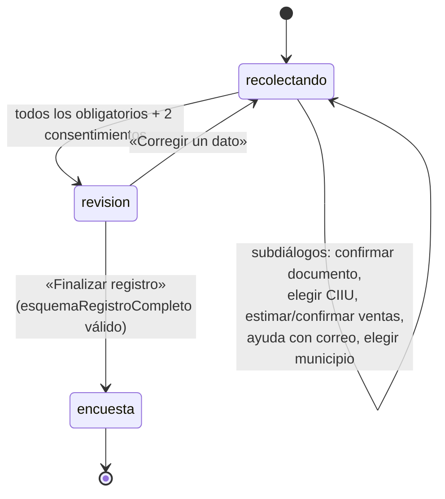
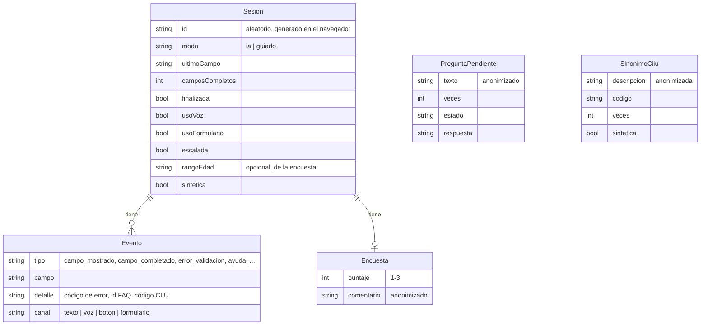

# Arquitectura

## Principio de diseño: híbrido determinista + IA

| Lo decide el código (determinista, probado) | Lo hace la IA (Claude) |
|---|---|
| Orden de los campos, qué falta, cuándo se avanza de paso y cuándo se puede finalizar (`lib/conversacion/estado.ts`) | Entender el lenguaje natural y extraer varios campos de un mensaje |
| Si un dato es válido: Zod + reglas de dominio (`lib/form/validadores.ts`) | Explicar en lenguaje sencillo, responder preguntas con la base de conocimiento |
| Confirmación del documento, aceptación de consentimientos, resumen y finalización (botones explícitos) | Proponer actividades CIIU (re-ordenar candidatos del catálogo) |
| Cálculo de ventas anuales, botones de respuesta rápida, bloques de interfaz | Decidir qué herramienta usar y redactar la respuesta |
| Seguridad: claves/OTP, inyección de prompt, límites, anonimización | — |

La IA **propone**; el código **valida y decide**. Si la IA no está disponible (sin clave, red caída, error o rechazo), el mismo motor responde en modo guiado, en el servidor o incluso en el navegador.

## Flujo general

## Un turno con IA, paso a paso

## Máquina de estados

Dependencias que el código aplica al cambiar un dato: cambiar el número de documento borra su confirmación; cambiar el tipo de documento revalida el número; cambiar el departamento borra la ciudad si ya no le pertenece.

## Modelo de datos (sin datos personales)

Los valores del formulario (nombre, documento, celular, correo, género, minoría…) **solo existen en el navegador** de la persona (localStorage, máximo 24 horas) y en el JSON final que se genera localmente.

## Piezas principales

| Pieza | Archivo |
|---|---|
| Campos del formulario (etiquetas, orden, ayudas, preguntas usted/tú) | `lib/form/campos.ts` |
| Validadores Zod y lectura de texto libre (dictado por voz incluido) | `lib/form/validadores.ts` |
| Parser de montos («10 palos», «2 millones al mes») y estimación de ventas | `lib/form/dinero.ts` |
| DIVIPOLA (33 departamentos, 1.122 municipios) | `lib/form/divipola.ts`, `data/divipola.json` |
| CIIU: búsqueda léxica + sinónimos aprendidos | `lib/form/ciiu.ts`, `data/ciiu/` |
| Máquina de estados y registro final | `lib/conversacion/estado.ts` |
| Motor guiado (reglas) y prerruteo determinista | `lib/conversacion/motor.ts` |
| Extractor de varios campos sin IA | `lib/conversacion/extractor.ts` |
| Prompt, herramientas, clasificación y turno con IA | `lib/ia/` |
| Protocolo de streaming (UI Message Stream del AI SDK) | `lib/servidor/flujo.ts`, `components/asistente/flujo-cliente.ts` |
| Analítica y métricas | `lib/analitica/` |
| Repositorios (Prisma SQLite/Postgres, memoria) | `lib/datos/` |

## Decisiones técnicas

- **Next.js 16 (App Router) + TypeScript + Tailwind 4 + shadcn/ui (Radix).** Las páginas principales son estáticas; `/api/chat` hace streaming.
- **Vercel AI SDK v7 + `@ai-sdk/anthropic`.** `streamText` con herramientas Zod, `isStepCount(5)`, instrucciones separadas de los mensajes (la versión 7 no admite mensajes de sistema dentro del historial, lo que ayuda contra la inyección), caché de prompt en la parte fija, `effort: "low"` y `fallbacks: "default"` del lado de Anthropic. Sin `temperature`: los modelos actuales rechazan valores distintos al predeterminado.
- **El stream se procesa a mano** en el navegador (SSE del UI Message Stream) en lugar de `useChat`, para poder caer al motor local si la red falla y para recibir el estado validado (`data-estado`) y las tarjetas (`data-bloque`).
- **Prisma 7 con driver adapters**: `better-sqlite3` en local y `pg` en Postgres. El esquema de Postgres se genera desde el de SQLite (`npm run db:esquema-postgres`), una sola fuente de verdad.
- **Analítica con `after()`** de Next: se guarda después de responder, sin demorar a la persona.
- **Sin librerías de gráficos** en el panel: barras y mapa de calor en HTML/CSS con una paleta validada para daltonismo y contraste.
